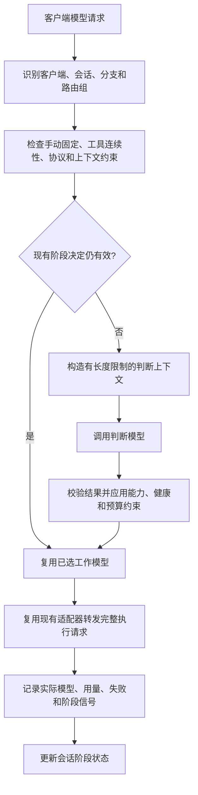

# ag-switch-pro 实施方案（待确认）

日期：2026-10-12。本文为方案，不代表已经实现或完成客户端联调。

## 1. 目标与边界

以 cc-switch 为应用基础，增加来自 magpie 思路的意图路由：每个路由组配置一个判断模型和一个或多个工作模型，让同一会话的不同执行阶段使用合适的模型，并把判断开销算入总成本。

“步骤”定义为 Agent 发起的一次模型请求；阶段可包含多个这样的请求。路由发生在请求发送上游之前，不能切换一次响应内部的推理过程，也不会代替客户端 Agent 执行 shell、文件修改或其他工具。

阶段示例：理解目标 → 收集资料 → 分析方案 → 实现修改 → 执行验证 → 处理失败 → 整理结果。阶段难度由具体任务决定：读取复杂源码、分析测试失败也可能需要强模型，不能仅按工具名称机械降级。

支持仅一个工作模型，作为接入和观测用途；至少两个不同能力或成本的工作模型才能形成有意义的分流。

## 2. 已核实的本地基础

本方案以本地源码为基准，没有检查远端是否更新：

| 项目 | 本地基准 | 可复用或参考部分 |
| --- | --- | --- |
| cc-switch | 96d636ca，package.json 版本 4.0.9 | Tauri 2、React / TypeScript、Rust、SQLite；供应商管理、客户端配置接管、代理、协议转换、流式处理、用量与故障处理 |
| magpie | e21ea07e | 路由组、意图分类、上一轮意图继承、判断缓存、并发合并、判断失败冷却、会话亲和性、路由解释 |

关键依据：

- `cc-switch/src-tauri/src/proxy/handler_context.rs`：请求上下文、供应商选择和会话 ID。
- `cc-switch/src-tauri/src/proxy/forwarder.rs`：实际请求转发及路由状态副作用。
- `cc-switch/src-tauri/src/mode/stack.rs`：聚合模型的独立目标与客户端模型别名。
- `cc-switch/src-tauri/src/proxy/session.rs`：现有会话 ID 提取；缺失时生成逐请求 UUID，不能直接作为跨请求保持依据。
- `cc-switch/src-tauri/src/proxy/providers/codex_chat_history.rs`：增量 Responses 历史恢复。
- `cc-switch/src-tauri/src/proxy/opaque_state_rectifier.rs`：跨供应商密文、压缩状态和子 Agent 任务的限制。
- `magpie/internal/gateway/classify.go`：通用判断模型、上一轮意图、缓存和并发合并；当前超时 8 秒、缓存 10 分钟、失败冷却 30 秒。
- `magpie/internal/gateway/decide.go`：专用决策 API 和推理强度选择。
- `magpie/internal/provider/group.go`：路由组与会话保持。

magpie 的通用意图路由默认在用户新消息到来时判断一次，并在这一轮后续工具调用中保持模型。本项目增加“轮次内阶段路由”，不把它描述为直接搬运即可获得的现成功能。magpie 的网页文档有版本说明，涉及当前行为时以源码为准。

两个项目均为 MIT；派生项目保留原许可证和版权，并说明借鉴来源。

## 3. 架构选择

### A. 在 cc-switch 的 Rust 代理中加入路由引擎（推荐）

沿用桌面界面、数据库、供应商和协议适配。增加一个内部调用入口，接受请求上下文和路由组，返回本次请求的模型目标、允许的备用目标及解释。判断、会话状态、能力筛选和费用控制封装在引擎内部。

优势是只有一个代理、一次协议转换和一套用量记录；请求取消、超时和流式状态有统一归属。代价是需要将 magpie 的相关行为用 Rust 实现，并认真隔离现有全局供应商切换逻辑。

### B. cc-switch 界面 + magpie Go 后台进程

桌面程序通过本地 API 配置 magpie，由 magpie 决定工作模型。能复用更多现有实现，但需要管理两套配置、进程、鉴权、日志和版本；cc-switch 代理与 magpie 网关的职责必须明确，避免重复转换与重复统计。轮次内阶段判断仍需新增。

### C. 新建负责规划和执行的 Agent

判断模型先拆分任务，再调用工作模型和工具执行各步骤，控制粒度最强。它需要接管客户端 Agent 的工具、权限、会话和恢复体系，产品范围超过本次以 cc-switch 为基础的路由增强。

选择 A。参考 magpie 的路由契约与测试场景，不引入它的完整 GUI、插件或订阅系统。第一版使用 cc-switch 已支持的供应商接入，专用 System One 类判断 API 留到后续。

## 4. 用户如何使用

1. 在现有供应商管理中配置模型。
2. 创建意图路由组，选择一个判断模型和一个或多个工作模型。
3. 为工作模型填写擅长任务、能力和价格，设置默认工作模型、异常回退模型。
4. 选择“每轮判断”或“阶段判断”；本项目核心模式为阶段判断。
5. 将路由组作为虚拟模型发布给 Claude Code / Codex，在客户端选择该组后自动分流。
6. 在路由记录中查看阶段、判断原因、实际模型和费用；需要时固定某个模型或暂停自动路由。

新增“意图路由”页面负责路由组配置和观测；运行时复用聚合模型目标机制。组虚拟模型触发自动路由，现有明确指定的模型继续直达其目标。手动固定优先于判断结果，不通过修改全局当前供应商来实现每个会话的选择。

发布虚拟模型时按客户端要求生成不同别名和模型目录。初期公开的上下文容量采用可自动切换成员的保守公共容量；大上下文模型可手动选择。不能向客户端承诺所有成员都具有最大成员的窗口。

## 5. 决策流程



判断上下文包括：最新目标、必要的近期对话、上一阶段与所选模型、最新工具结果的有限摘录、工具失败标记和候选模型说明。大文件、完整工具定义及整段会话不会在每次判断时全部重复发送。

工作模型仍收到执行所需的原始完整请求；压缩判断输入不等于裁剪执行上下文。第一版使用确定性的摘取与截断，不增加额外摘要模型调用；确需模型摘要时，必须计入判断费用。

判断结果采用结构化字段：阶段、候选工作模型 ID、简短原因、建议连续请求数和可选推理强度。输出只允许引用已配置的模型，不能提供 URL、凭证或可执行指令。格式不合法、模型不在候选集合或能力不符合时，使用明确的回退策略并记录原因。

判断模型自己的调用使用内部调用标记并绕过意图路由，避免递归。取消与总超时继承外层请求；判断费用另行归因，但纳入会话总成本。

## 6. 阶段保持与重新判断

每次决定带有限的有效期和请求数上限，例如建议沿用 3 次、上限 5 次；这些是初始可配置值，需要实测调整。表示未来若干请求在约束仍满足时沿用模型，不表示提前准确知道未来会执行哪些工具。

触发重新判断的条件：

- 用户提出新目标或纠正方向。
- 收集资料转入实现、验证失败转入诊断等阶段变化；判断发生在下一次模型请求前。
- 当前保持次数耗尽，按预算允许进行一次阶段检查。
- 当前模型出现已知不兼容、上下文不足、不可用等情况。

阶段变化由请求中的对话、工具调用及结果推断。代理不能可靠读取模型未公开的计划，也不能把所有测试失败都归为复杂任务。界面应允许查看与纠正路由，判断的不确定性通过保守保持或回退处理。

“继续”“照着做”应结合既有目标和阶段解释；不能因为用户消息短就降级。“读取文件”也不能自动等同低难度。

相同请求重试不得重复消耗阶段次数；缓存键包含会话分支、路由组配置版本、候选集合和阶段输入摘要。重复判断合并在途调用，模型或策略更新后旧决定失效。不同分支并发执行使用独立状态和版本校验。

## 7. 模型选择与连续性约束

工作目标由 `provider_id + model_id + 执行参数` 唯一确定。同一家供应商下的多个模型可以分别参与选择。

先筛选协议、工具调用、图片及其他必要能力、上下文容量，再判断意图和成本。没有合法目标时给出具体错误，不删除关键工具或媒体内容后继续执行。

自动换模型必须满足：工具调用 ID 与返回结果完整保留；目标模型能承接当前工具协议；历史可完整重放或可靠恢复；不存在仅原供应商可使用的状态。

对仅持有 `previous_response_id` 的请求，先恢复历史；不能恢复时保持原供应商。对于无法移交的加密推理、压缩状态或子 Agent 加密任务，固定到兼容目标并解释原因。不能把删除重要密文状态作为默认换模型办法。

已经开始向客户端输出的响应不在中途更换模型。上游输出前的可恢复故障才尝试事先配置且兼容的备用目标；重试次数有界。流式失败不能被当成阶段信号立即重放整个回答。

会话键至少区分客户端、路由组、真实 session 和分支。cc-switch 现有随机 UUID 只能关联单次请求。没有可信会话 ID 时，只有客户端适配器能确定关联才做跨请求保持，否则退回逐请求决定；不凭相同首句话合并会话。主 Agent 与子 Agent 不共享同一份阶段状态。

## 8. 成本、质量与观测

优化目标是任务质量满足要求下减少总费用、延迟和不必要的高级模型使用。便宜模型可能消耗更多 Token 或重试，所以不承诺同时减少所有 Token，也不预设节省比例。

会话总费用 = 工作模型费用 + 判断模型费用 + 重试与备用请求费用 + 额外摘要费用（如启用）。缓存读写按上游真实用量计费；价格或用量缺失时显示未知，不当作免费。

初期预算控制以已知价格和输出上限做估算，不宣称绝对账单硬上限。判断预算耗尽后沿用合法现有决定或指定回退，不默默持续调用判断模型。

记录：请求与决定关联 ID、客户端与会话、阶段、候选与排除理由、判断来源、缓存命中、建议和实际目标、切换或保持原因、判断耗时、执行耗时、Token、费用与失败。日志默认不落盘完整会话正文或凭证。

判断模型自报置信度不是经过校准的正确率，不能单独作为强制降级依据。测试质量、任务完成率、人工纠正率和反复升级次数共同用于调整策略。

提供三种运行方式：实际路由；观察模式（只记录建议，实际固定模型）；暂停路由。观察模式仍有判断费用，页面必须说明。

## 9. 数据与代码落点

计划在确认后建立项目布局：

```text
ag-switch-pro/
  app/                       # 从 cc-switch 受版本控制的源码建立派生应用
    src/                     # 现有 UI + 路由组设置和决定记录
    src-tauri/src/
      proxy/intent/          # 路由引擎、判断调用、阶段与兼容性处理
      database/              # 配置和日志迁移
      commands/              # 前后端配置与记录接口
  docs/
    ag-switch-pro-plan.md
  cc-switch/                 # 当前本地参考仓库，保持原样
  magpie/                    # 当前本地参考仓库，保持原样
```

新项目不复制参考仓库的 `.git`、构建产物或本地凭证。路由组配置和决定记录使用新增数据库表；短期阶段状态驻留内存并有容量与失效策略。应用标识、数据目录、代理端口、客户端接管标记和更新来源与 cc-switch 分开；默认关闭继承的上游自动更新，避免被原项目更新覆盖。

复用退出恢复和配置备份机制，并加入不同代理共同接管的检测。同一客户端在同一时刻只由一个应用接管。

## 10. 交付顺序

1. **派生应用与基础路由**：建立 ag-switch-pro 独立身份，保留 cc-switch 功能；实现一个判断模型、一个或多个工作模型、虚拟路由组、每轮判断、手动固定和清晰回退。
2. **轮次内阶段路由**：实现有限上下文判断、阶段保持、重新判断、并发隔离、连续性检查和缓存。这一阶段完成才达到用户要求的核心功能，不能停留在第一阶段。
3. **费用与解释界面**：配置、模拟判断、记录、统计、观察模式、预算和质量回溯；实际用量与估算明确区分。
4. **客户端联调与发布验证**：先 Claude Code、Codex HTTP Responses 及所需 Chat / Messages 转换；其他客户端和专用判断 API 后续扩展，不承诺未联调协议。

## 11. 验收

- 简单问答可选择便宜工作模型，复杂设计可选择强模型；“继续”继承任务语境。
- 同一个用户轮次内，资料收集、实现、复杂排错阶段可以在合法请求边界选择不同模型。
- 一组连续请求复用决定，重试不重复判断、不重复扣次数；判断调用无递归。
- 判断超时、非法输出、不可用目标、预算耗尽都有可核对的回退行为。
- 多会话、分支和主 / 子 Agent 不串状态；变更配置能使旧决定失效。
- 工具 ID、流式行为和可移交历史保持正确；不能移交时固定原目标或明确报错。
- 当前应用全局供应商不会被一个会话的路由决定改写。
- 用量包含判断、工作和重试；价格或上游用量缺失不产生虚假的精确节省率。
- 使用模拟上游覆盖协议与状态机，再以用户配置的真实模型完成 Claude Code / Codex 联调；模拟测试不称为真实模型验证。
- 在隔离任务副本上比较固定强模型与自动路由：任务完成率、测试结果、总费用、总耗时、判断开销及缓存变化。观察模式只能评估建议，不能证明换模型后的执行质量。

方案确认后才创建派生应用、修改源码和开始测试。本轮只新增本文档。
