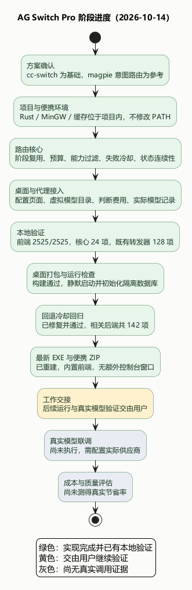
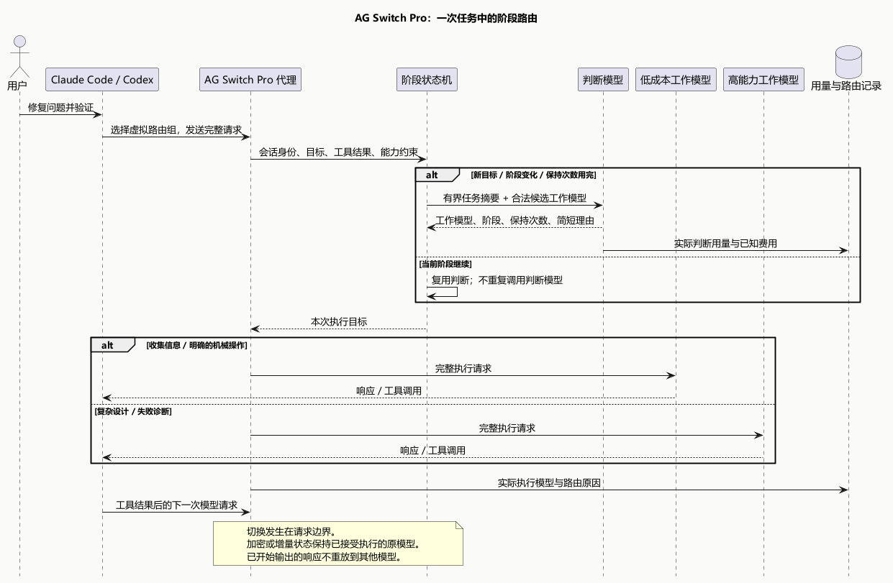

# 阶段费曼汇报：2026-10-14

已将设计落实为独立的 Tauri 桌面项目、路由核心、配置页面和 Claude Code / Codex 代理接入。回退冷却缺陷已修复并通过回归。按用户后续要求，最新源码已重新构建为双击可运行的 Windows 图形界面 EXE，便携 ZIP 同步更新。后续运行与真实模型验证交由用户执行，实际模型质量与成本对比尚未开展。

## 用最简单的方式解释

把一次编程任务看作一个工作小组：判断模型是调度员，工作模型是不同能力与价格的成员。调度员读取任务摘要、最近的工具结果和候选能力说明，决定接下来几次模型请求交给谁。

例如「修复并发问题」：复杂分析和方案设计适合强模型；按照已经明确的方案读取文件、修改固定内容可以交给低成本模型；验证失败后，调度员再判断是否需要回到强模型诊断。模型名字不代表能力，选择依据是用户配置的能力说明以及实际请求约束。

如果每一步都重新问调度员，调度费用可能抵消节省。因此系统会保持一段阶段判断，对重复请求不重复计入判断调用。新目标、工具失败、阶段变化或保持次数用完时才重新判断；还可以设置整段会话的判断预算。

系统能切换的是下一次模型请求。单次响应内部的推理步骤对代理不可见，不能承诺在那里切换模型。加密或增量状态属于原供应商时，继续由已接受执行的原模型处理；缺少来源证据时拒绝转移。

## 已完成的链路

| 环节 | 实现与作用 |
|---|---|
| 独立应用 | 使用 AG Switch Pro 名称、端口 15722、数据目录与深链接，避免混用参考项目身份 |
| 路由配置 | 一个判断模型、一个或多个工作模型、能力说明、默认/回退/固定模型 |
| 请求处理 | 虚拟路由组模型目录、按会话和分支维护状态、按阶段选择执行目标 |
| 控制开销 | 连续请求复用、重复判断去重、调用预算、超时与失败冷却 |
| 保持正确性 | 工具/图片/上下文过滤、保留完整执行正文、输出开始后不跨模型重放 |
| 可检查性 | 记录实际工作模型、判断用量、可获得的费用和选择理由 |
| 环境 | Rust 与匹配 MinGW 来自压缩包，存于项目内；不修改 PATH |

保存路由组只保存配置和同步已接管客户端的模型目录。用户需要在页面点「启动客户端路由」，再在客户端选择路由组。「试判断」会真正调用判断模型并计费，工作模型不执行任务。

## 验证结果与范围

- 路由核心：24 项通过，覆盖阶段变化、并发去重、未知会话、预算、故障与状态归属。
- 代理接入：6 项通过；冲突保护：1 项通过。使用本地模拟上游，不调用外部模型。
- 既有转发器：128 项通过，包含流式首块处理和失败分类回归。
- 数据库迁移：7 项通过，旧库沿既有迁移链进入新增路由表版本。
- 新增前端功能：10 项通过；测得语句/行覆盖率 95.76%，分支 91.30%，函数 82.92%。
- 完整前端回归：2525 项通过。App 集成测试将冷启动模块加载移入 setup 后，保留了操作原有的 10 秒时限。
- 相关后端共 142 项通过，包含本次回退冷却回归。最新修复已重新打入 EXE 与便携包，包内程序哈希与最新构建一致；详见 [验证记录](validation.md)。

本次冷却缺陷是：自动判断已经排除失败模型，但执行回退列表还能把它加回来。新增测试先复现「预期 1 个目标，实际 2 个」，修复后回退列表同样检查冷却状态，测试转为通过。

Rust GNU 工具链缺少 `profiler_builtins`，尚未获得 Rust 覆盖率数字；通过测试数量不能替代覆盖率。真实供应商兼容性、模型选择质量、实际节省比例都尚未测量。

## 图与代码入口

- 可编辑源：`progress.puml`、`intent-routing-flow.puml`。
- 设计依据：[已确认方案](ag-switch-pro-plan.md)。
- 接口行为：[意图路由约定](intent-routing-contract.md)。
- 复现命令和使用步骤见项目根目录 `README.md`。
